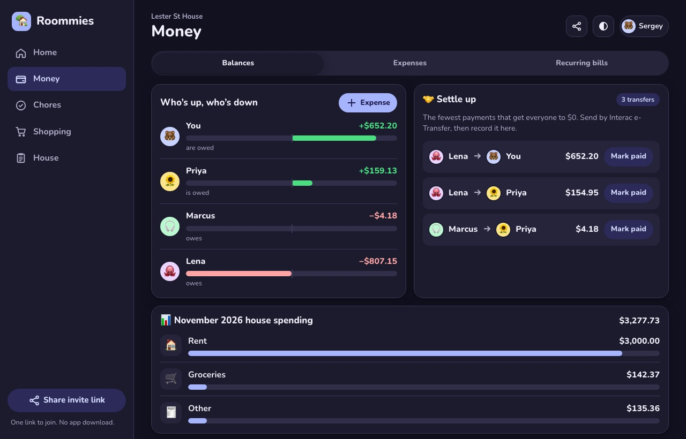
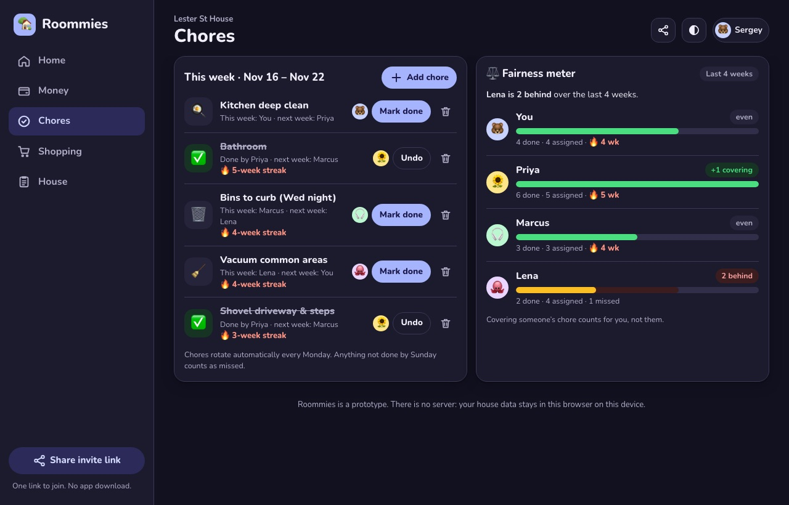

# Roommies

A home base for roommates that replaces the messy group chat: shared money, chores and house info in one place, so the group chat can go back to being social.



This is a **single-file prototype** (`index.html`, about 105 KB, vanilla JS, no dependencies besides an optional Google Font). Open it in any browser. There is no server: all data lives in this browser's `localStorage`. If storage is blocked (private mode, sandboxed iframe), the app still works in memory and shows a banner saying changes won't be saved.

## Positioning

- **Who:** students sharing houses and apartments, starting with Waterloo, Ontario (UW / Laurier off-campus houses, 3–6 people, 8- or 12-month leases).
- **Wedge:** one link to join a house, no app download. Money, chores and house info in one place.
- **Why they switch:** today the house runs on a group chat plus Splitwise plus a fridge whiteboard plus "what's the Wi-Fi password again?". Roommies is the one link that covers all of it, so the chat can go back to memes.

## What works in the prototype

1. **Onboarding**: "Try the demo" loads *Lester St House* (Sergey, Priya, Marcus, Lena) with about a month of realistic history. "Start fresh" creates a house (name, optional address) with housemates (name, emoji avatar, colour).
2. **Money**
   - Add expenses: who paid, amount in CAD, category (rent, utilities, groceries, internet, other), date, split equally or by custom amounts among the people you pick. Custom splits must add up to the total exactly.
   - All arithmetic is in **integer cents**. Equal splits give leftover cents to the first people, so shares always add up to the total.
   - **Recurring monthly bills** (rent, hydro, internet…) with a due day, status (due in N days / overdue / paid this month), and "Log payment" that posts and splits that month's amount.
   - **Balances** per person, and **Settle up** with the **fewest possible transfers**: a bitmask DP finds the largest number of zero-sum subgroups, then each subgroup is settled greedily. This is exactly optimal up to 16 people, with a greedy fallback (at most n−1 transfers) above that. "Mark paid" records an Interac e-Transfer as a payment.
   - This month's spending by category.
3. **Chores**: weekly rotation that advances automatically every Monday. Mark done (anyone can cover for someone else), undo, per-chore streaks, per-person streaks, and a **fairness meter** over the last 4 weeks (done vs. assigned, missed chores, who's behind, who's covering).
4. **House board**: Wi-Fi name with a masked password (Reveal and Copy), quiet hours, guest policy, house rules (add and remove), lease start and end, rent due day, landlord placeholder and contact, and a **key-dates countdown** (bills, rent, lease end, and the 60-day notice deadline before lease end; Ontario Form N9, check your lease).
5. **Shopping list**: add items, "I'll buy it" to claim, then "Bought it" turns the receipt into a shared expense (or just marks it bought).
6. **Activity feed** of recent actions on Home.
7. **Share invite link** copies a demo link (`https://roommies.app/join/...`, not live) and shows a toast. A footer note says this is a prototype and data stays on this device.

There are no logins, so "Acting as" (the avatar at top right) lets you switch which housemate is using the device.

Design: mobile-first (bottom tab bar on phones, sidebar from 900px up), works at 375px with 16px gutters and no horizontal scroll. Light and dark themes (follows the system, with a manual toggle), all colours are CSS custom properties, WCAG AA contrast on text tokens, visible focus rings, real `<button>`s and native `<dialog>`s.

## Screenshots

| Home | Chores |
|---|---|
|  |  |

## Run it

Download `index.html` and open it in a browser. That's it. To use it as a desktop app on a Mac, wrap it with [html2mac](https://github.com/sergeygruzd/html2mac).

## Tests

```sh
./test/run_tests.sh
```

The script pulls the two inline scripts out of `index.html` and runs them with Node if it's installed, otherwise with macOS's built-in JavaScriptCore (`jsc`). It runs:

- `test/logic.test.js`: unit tests for cents parsing and formatting (including float traps and 2,000 random round-trips), equal splits (2,000 random cases), balances, settle-up (1,500 random cases checked against an independent brute-force optimum), dates across DST, bill due dates, chore rotation, fairness and streaks.
- `test/smoke.test.js` + `test/smoke.after.js`: boots the real UI script against a tiny fake DOM and clicks through the whole app: demo, every tab, adding equal and custom expenses, validation errors, logging a bill, shopping claim to expense, settling everyone to $0.00, Wi-Fi reveal, HTML escaping, invite, theme, adding and removing housemates, reset, and start fresh.
- Boot with `localStorage` throwing on every call, and with corrupted saved data.

## 5 next steps to make it a real product

1. **Backend + auth: Supabase** (Postgres + Row Level Security + Auth). Magic-link email or Google sign-in, no passwords, so it stays "one link, no download". A `house_members` table plus RLS policies give per-house isolation for free, and Realtime channels give live updates when a housemate adds an expense. (Firebase would also work. Supabase wins on relational data like expenses and shares, and on SQL for settle-up audits.) Keep money as integer cents in `bigint` columns, and make expenses append-only with soft deletes for an audit trail.
2. **Real invite links + PWA**: signed, expiring join tokens (`/join/<token>`), with a landing page that previews the house before sign-in. Make it an installable PWA (manifest + service worker) with offline queueing, so it feels like an app without the App Store.
3. **Notifications that replace the chat nags**: web push and email digests for "Hydro due in 3 days", "Your chore this week", "Lena paid you $154.95". Weekly Sunday-night summary. Quiet-hours aware.
4. **Payments where it counts**: Canadian students settle by Interac e-Transfer, so deep-link "Pay Sergey $652.20" with the amount and memo prefilled, plus receipt photo upload (Supabase Storage) and OCR for amounts. Then bank-feed or Interac request-money integrations once there's traction.
5. **Distribution + lease lifecycle in Waterloo**: partner with off-campus housing offices, student-landlord property managers and residence dons. Add move-in and move-out flows (deposit tracking, final settle-up, handing the house over to next year's tenants, who become the next cohort of users). Measure: houses created, % of members joined within 48h, weekly active houses, expenses per house per month.

## Competitors (honest take)

- **Splitwise**: the default for splitting bills, and very good at it (debt simplification, multi-currency, a huge user base). Its free tier now limits daily expenses and adds ads, which annoys students. It does nothing for chores or house info. Roommies has to be *as good* at money for houses, not better at money in general.
- **Flatastic**: the closest direct competitor (chores, shopping list, expenses, pinboard for shared flats). It's popular in German-speaking Europe and has little presence in Canadian student housing. Its feature set overlaps heavily with this prototype, so the differentiators have to be the no-download join link, Canadian student specifics (e-Transfer, lease and N9 dates, Waterloo distribution) and polish.
- **OurHome**: chores and rewards with a family focus (parents and kids, points). Free and decent for chores and groceries, but no real expense splitting, and the family framing doesn't fit roommates.
- **Tody**: a polished cleaning tracker based on how dirty each area is rather than on assigned rotations. Great for one household manager, weak on "whose turn is it", and has no money features.

**Bottom line:** none of these are bad. The risk is that "Splitwise + group chat" is good enough. Roommies wins only if joining is near-instant and the house actually stops using the group chat for logistics, so the onboarding and invite flow matter more than any single feature.

## How it was built

Designed by Sergey Gruzd and built with Claude Code (AI pair programming): I set the product scope, the Waterloo student-housing angle and the rules (integer cents, fewest transfers, fairness), and reviewed and tested the result.
