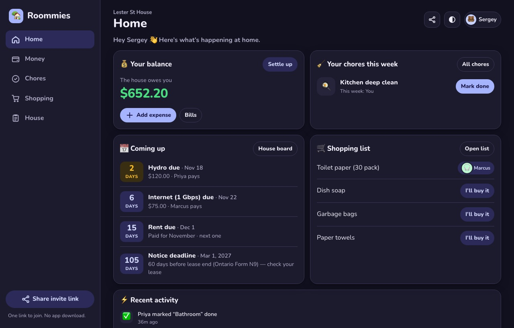

# roommies

shared money, chores and house info for student houses. basically trying to replace the group chat + splitwise + whiteboard on the fridge combo every waterloo house runs on.


right now it's a single-file prototype: just `index.html`, vanilla js, no backend. data is saved in the browser's localStorage. open the file and hit "try the demo".

## what's in it

- **money**: add expenses, split equally or custom, recurring bills (rent, hydro, internet), balances, and settle up with the fewest transfers possible. everything is stored in integer cents so nothing drifts by a penny
- **chores**: weekly rotation that moves every monday, streaks, and a fairness meter for the last 4 weeks (who's behind, who's covering)
- **house board**: wifi password, quiet hours, house rules, lease dates and a countdown to the 60 day notice deadline
- **shopping list**: claim an item, mark it bought, and it turns into a shared expense
- light/dark mode, works on a phone

no logins yet so there's an "acting as" switch in the top right to pretend to be different housemates.

| home | chores |
|---|---|
|  |  |

## settle up

the interesting part. the naive way to settle debts takes up to n-1 transfers. the fewest-transfers version is: find the biggest number of groups of people whose balances sum to zero, since each group of size k needs k-1 transfers. i do that with a bitmask dp over subsets, which is exact up to 16 people, and fall back to greedy above that. tested against a brute force on 1500 random cases.

## tests

```sh
./test/run_tests.sh
```

runs with node if you have it, otherwise macos's built in `jsc`. unit tests for money math, splits, settle up, dates/dst and chore rotation, plus a smoke test that clicks through the whole ui on a fake dom.

## next

- supabase for accounts + real invite links (one link to join, no app download)
- reminders for bills and chores
- interac e-transfer deep links for paying people back

closest competitors are splitwise (money only) and flatastic (similar idea, mostly in germany). honestly the hard part isn't features, it's getting a whole house to actually switch.

built with claude code as a pair programmer. desktop version is wrapped with [html2mac](https://github.com/sergeygruzd/html2mac).
